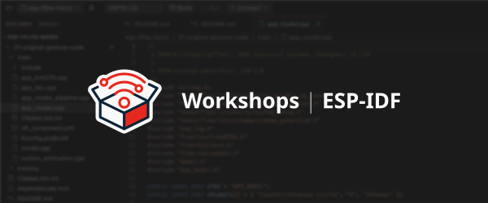

# ESP Workshops

Choose a workshop to open it directly in your browser:

| Workshop | Description |
| --- | --- |
| [ESP-TFLite-Micro](idfweb:project?path=esp-tflite-micro&preset=editing) | Build a gesture-recognition application for the ESP-SensairShuttle with ESP32-C5. |
| [Introduction to ESP32-S31 Security](idfweb:project?path=introduction-to-esp32-s31-security&preset=editing) | Explore TLS, encrypted storage, Secure Boot, flash encryption, and signed OTA updates. |
